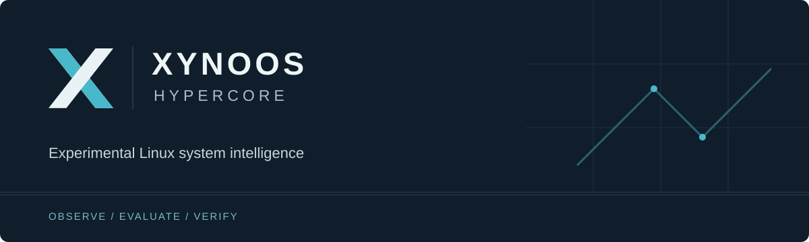
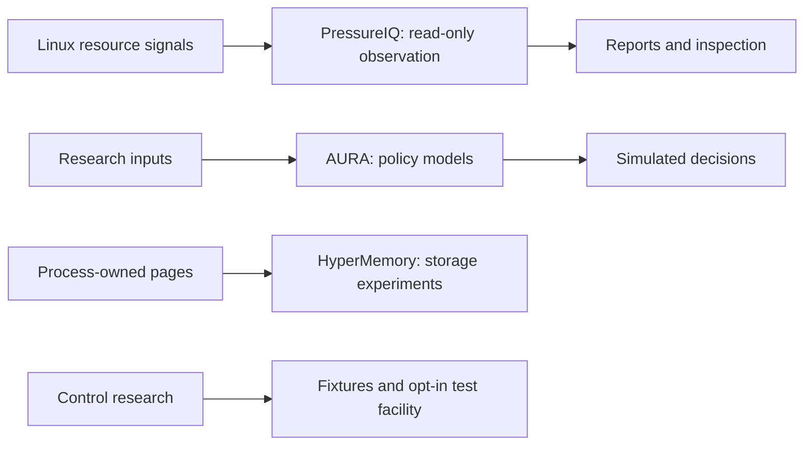

<p align="center"></p>

# Xynoos HyperCore

**Experimental Developer Preview · Linux resource intelligence, built around evidence.**

[](LICENSE)
[](docs/README.md)

Xynoos HyperCore is a Rust workspace investigating Linux resource telemetry, policy simulation and cooperative memory management. Its research combines read-only observation, bounded models and recorded experiments to make resource tradeoffs easier to examine.

> **Experimental research software; not production-ready.** No reproducible desktop-wide performance benefit has been demonstrated. Physical kernel mutation remains **NO-GO** for production use; active ZRAM tuning is not implemented.

[Install the preview](#install-the-developer-preview) · [Architecture](docs/ARCHITECTURE.md) · [Safety](#safety-and-limitations) · [Evidence](#experimental-evidence) · [Documentation](docs/README.md)

## Install the developer preview

Published Linux x86_64 preview. The public release installation lifecycle has been
verified in a disposable HOME on Ubuntu 24.04 Codespaces. Debian 13 / XFCE on the
Pentium Silver N5000 remains the primary **untested hardware target**.

```sh
curl -fsSL https://raw.githubusercontent.com/samuelindra123/xynoos-hypercore/main/install.sh | sh && export PATH="$HOME/.local/bin:$PATH"
```

```sh
xynoos doctor
xynoos status
xynoos diagnose --count 10 --interval-ms 1000 --json
xynoos update
xynoos rollback
```

Installs for your user without sudo, a source checkout, Rust, manual extraction or
GitHub login. Requires curl, Python 3.9+, OpenSSL 3 and CA certificates. The final
PATH assignment makes `xynoos` available immediately in this terminal.

The small HTTPS bootstrap pins installer source. The installer verifies a pinned
Ed25519 release signature, signed provenance identity, binary SHA256, platform and
executable identity **before** activation. Initial bootstrap trust is GitHub/TLS and
repository control; checksum sidecars alone are not authenticated provenance.

[Release notes and assets](https://github.com/samuelindra123/xynoos-hypercore/releases) ·
[Trust model and pinned alternative](docs/INSTALL.md#pinned-auditable-alternative) ·
[N5000 OpenCode validation protocol](docs/N5000-PREVIEW-VALIDATION.md)

`update` chooses published compatible previews with SemVer-aware discovery.
`rollback` works offline after a previous verified version has been retained.
`uninstall` removes owned releases and preserves diagnostic evidence. No daemon or
active optimizer starts. Other distributions are compatibility targets, not promises.

## What exists today

- **PressureIQ** collects read-only Linux memory, CPU, I/O and other visible system signals. Sources are read sequentially and may be unavailable or have different scopes.
- **AURA** explores deterministic policy and placement models using simulated resource costs. The research models do not move kernel pages.
- **HyperMemory** stores and verifies pages owned by a participating process, using compressed or adaptive representations. It does not transparently manage unrelated applications.
- **Control research** includes cgroup inspection and transaction fixtures. The separate opt-in empty-child kernel test has strict prerequisites and does not establish production safety.

## Architecture



These are research components with distinct interfaces; this diagram does not imply an automatic system-wide control loop. See the [architecture](docs/ARCHITECTURE.md) and [telemetry report](docs/reports/TASK-014-UNIFIED-SYSTEM-INTELLIGENCE-REPORT.md).

| Capability | Current scope |
| --- | --- |
| Linux observation | Read-only; availability depends on the host and permissions |
| Policy and placement | Research models and simulations, not live optimization |
| Cooperative memory | Experimental storage for data owned by the participating process |
| Kernel control | Research fixtures and a narrowly scoped opt-in test; production mutation is NO-GO |
| Active ZRAM tuning | Not implemented |
| Desktop-wide optimization | No reproducible benefit demonstrated |

## Development builds

Install a Rust toolchain and Cargo. Live telemetry requires Linux. From the repository root:

```sh
cargo build --workspace
cargo run -p xynoos-cli -- pressure snapshot --human
cargo run -p xynoos-cli -- system snapshot
```

These snapshot commands read visible system information; they do not tune the host. To run the workspace tests, use `cargo test --workspace`. For more commands and the scope of each research milestone, see the [research history](docs/RESEARCH-HISTORY.md).

## Experimental evidence

The [TASK 002 report](docs/reports/TASK-002-MEMORY-CORRECTNESS-BENCHMARK-REPORT.md) measures a page store across several datasets; batch averages and process-wide memory readings have specific interpretation limits. [TASK 003](docs/reports/TASK-003-ADAPTIVE-STORAGE-REPORT.md) investigates adaptive storage accounting. These experiments concern cooperating, owned-memory workloads, not arbitrary applications or desktop-wide savings.

The [unified telemetry report](docs/reports/TASK-014-UNIFIED-SYSTEM-INTELLIGENCE-REPORT.md) records collection measurements in its tested Linux environment; these are not laptop optimization results. The [workload validation report](docs/reports/TASK-017-REAL-WORKLOAD-VALIDATION-REPORT.md) describes its own methodology and limitations. Read the reports and raw data before drawing conclusions.

## Safety and limitations

The project favors explicit scope, observable evidence and conservative interpretation. Telemetry can be partial, stale or namespace-dependent. Page-store accounting is not total process RSS, and compression can cost CPU or increase storage. The [kernel transaction report](docs/reports/TASK-015C-REAL-KERNEL-TRANSACTION-REPORT.md) describes a separate, opt-in empty-child test facility and its risks; fixture results do not establish physical safety. Durable physical recovery and production workload control are not established. The quick-start commands require no root daemon, kernel module or global swap changes.

## Repository guide

| Path | Contents |
| --- | --- |
| [`crates/`](crates/) | Rust workspace components and CLI |
| [`docs/`](docs/README.md) | Architecture, research history, reports and benchmark data |
| [`scripts/`](scripts/) | Research measurement and summarization tools |

## Direction and contributing

Future work depends on reproducible evidence, representative workloads and independent safety review. Ideas are not promises of availability. Contributions that improve reproducibility, documentation, tests and careful review are welcome. Include the environment, steps, evidence and scope of any claim in an [issue](https://github.com/samuelindra123/xynoos-hypercore/issues) or pull request.

## License

Xynoos HyperCore is licensed under [GNU GPL-3.0-only](LICENSE). Project history identifies Samuel Indra Bastian and contributors.
