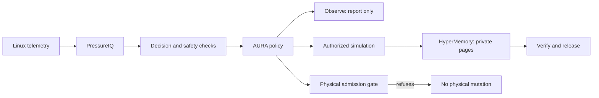

<p align="center"></p>

# Xynoos HyperCore

**Experimental Linux system intelligence, built around evidence and bounded action.**

[](LICENSE)
[](docs/ROADMAP.md)

Xynoos HyperCore is a Rust workspace for investigating how Linux telemetry, policy and cooperative memory management can respond to resource pressure. It brings observation, simulation and narrowly scoped experiments together with their evidence and safety boundaries.

> **Experimental research software; not production-ready.** No reproducible desktop-wide performance benefit has been demonstrated. Physical kernel mutation remains **NO-GO**, and active ZRAM tuning is not implemented.

[Get started](docs/MVP-QUICKSTART.md) · [Architecture](docs/MVP-ARCHITECTURE.md) · [Safety](docs/MVP-SAFETY-RECOVERY.md) · [Evidence](docs/reports/MVP-RESULTS.md) · [Documentation index](docs/README.md)

## What exists today

- **Observe:** read visible Linux resource telemetry and report its availability.
- **Evaluate:** replay bounded traces through deterministic policy decisions.
- **Experiment:** simulate authorized compression of a private, process-owned corpus, verify its bytes and release it.
- **Inspect:** review simulation evidence and non-mutating recovery diagnostics. Physical admission refuses.

These paths do not transparently optimize unrelated applications. Telemetry may be missing or stale, and the integrated physical control path is disabled and unverified.

## Architecture



**PressureIQ** qualifies resource signals. The decision engine checks freshness and pressure conditions before **AURA** selects a policy. **HyperMemory** provides bounded storage for the simulation's own pages. Safety checks, explicit authorization, verification and a locked physical admission boundary constrain the experiment. See the [architecture](docs/MVP-ARCHITECTURE.md) and [mutation audit](docs/reports/TASK-018E-MUTATION-SINK-AUDIT.md) for details.

| Capability | Current scope |
| --- | --- |
| Linux observation | Read-only; host and permission dependent |
| Policy simulation | Bounded trace replay; deterministic decisions for a given trace |
| Cooperative memory | Experimental, process-owned data only |
| Recovery | Simulation evidence and read-only diagnostics; no durable physical recovery |
| Kernel control / active ZRAM tuning | Physical mutation NO-GO; active ZRAM tuning not implemented |
| Desktop-wide optimization | No reproducible benefit demonstrated |

## Quick start

A Rust toolchain and Cargo are required. Live telemetry requires Linux. From the repository root:

```sh
cargo build --workspace --release
./target/release/xynoos-cli mvp observe --count 1 --human
./target/release/xynoos-cli mvp simulate --human
./target/release/xynoos-cli mvp recovery --human
```

Observation is read-only; simulation uses bounded private data. Recovery diagnostics do not replay physical writes. The [quickstart](docs/MVP-QUICKSTART.md) covers prerequisites, traces and simulation journals.

## Evidence and limits

The [MVP comparison](docs/reports/MVP-RESULTS.md) used a small mixed private corpus and synthetic pressure replay on a Codespaces x86_64 host. Its median response was 134.000 µs for baseline and 168.314 µs for policy simulation; these are microbenchmark measurements, not desktop latency or a general speedup. Full-process RSS did not demonstrate a memory reduction in that experiment.

A separate [owned-memory experiment](docs/reports/PHASE4-OWNED-PERFORMANCE.md) retained less memory on a compressible corpus at CPU and completion-time cost. Its evidence applies to cooperating, owned-memory workloads, not arbitrary applications. The [laptop study](docs/reports/PHASE4-LAPTOP-RESULTS.md) did not demonstrate a reproducible acceptable benefit. Operator-supplied N5000 observations indicate substantial memory pressure and swap activity, but the raw laptop evidence was not supplied for independent inspection; the later diagnostic artifact is from Codespaces, not the N5000. See the [N5000 guide](docs/MVP-N5000-VALIDATION.md) for the outstanding validation.

## Safety and recovery

Xynoos favors observation, explicit authorization, bounded ownership and refusal when evidence is incomplete. Simulation journals do not provide physical crash recovery. Exclusive delegation, durable physical recovery and cleanup under failure remain open. The examples above need no root daemon, kernel module or global swap changes. Read the [safety contract](docs/MVP-SAFETY-RECOVERY.md) before experimenting.

## Environments

The recorded MVP comparison and static Linux x86_64 package were exercised in Codespaces on an AMD EPYC host. MX Linux and a physical N5000 were not validated by that MVP study. Linux telemetry depends on the host and visible namespace; benchmark harnesses require Python 3.9 or newer. See the [results](docs/reports/MVP-RESULTS.md) and [benchmark method](docs/MVP-BENCHMARK.md) for exact scope.

## Repository guide

| Path | Contents |
| --- | --- |
| [`crates/`](crates/) | Rust workspace components and CLI |
| [`docs/`](docs/README.md) | Guides, architecture, safety and research reports |
| [`artifacts/`](artifacts/) | Recorded experimental evidence and package metadata |
| [`benchmarks/`](benchmarks/) · [`scripts/`](scripts/) | Measurement and quality tools |
| [`fixtures/`](fixtures/) | Simulation inputs |

## Roadmap and contributing

The [roadmap](docs/ROADMAP.md) separates existing foundations from validation gates and future ideas. The [review backlog](docs/PROJECT-BACKLOG.md) documents unresolved risks. Contributions improving reproducibility, documentation, tests and careful review are welcome. For a bug report or proposed change, include the environment, steps, evidence and the scope of any claim. Browse [open issues](https://github.com/samuelindra123/xynoos-hypercore/issues) or submit a pull request.

## License

Xynoos HyperCore is licensed under [GNU GPL-3.0-only](LICENSE). Project history identifies Samuel Indra Bastian and contributors.
