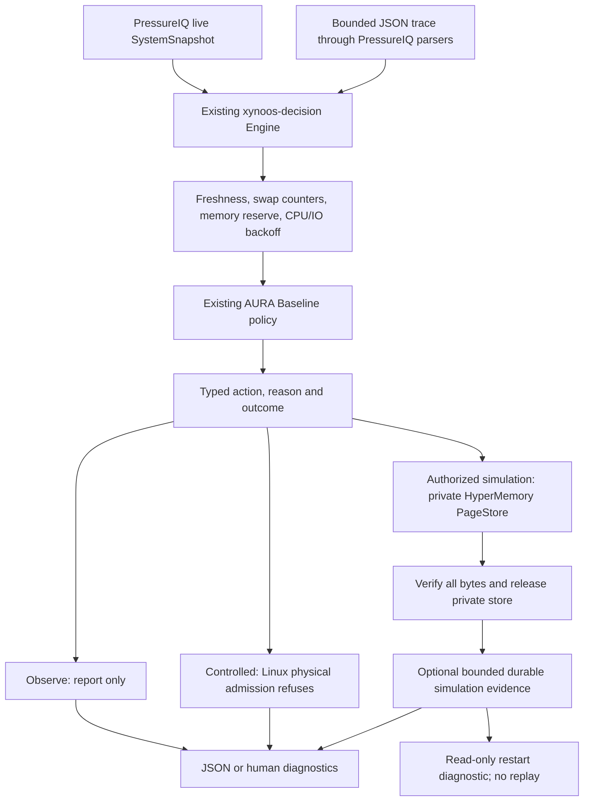

# Integrated MVP architecture

The new `xynoos-engine` crate composes existing implementations. `xynoos-cli mvp`
and the restricted `xynoos-mvp` binary use the same command implementation;
`xynoos-bench --mvp MODE` uses the same replay engine as the CLI.

PressureIQ collects CPU, memory and I/O PSI, meminfo, vmstat and optional cgroup
context. Collection is sequential and scoped to the visible namespace. Existing
`xynoos-decision::Engine` validates the contract and sources, requires two fresh
observations, uses PSI entry 10% / exit 5%, retains at most eight observations,
and applies its existing ten-second transition cooldown. `Decision` now exposes
CPU/memory/I/O active states as typed booleans so callers never parse explanations.

The MVP adds required swap counters with reset detection and a five-second
memory-snapshot age check. Invalid telemetry resets policy history. At less than
200 MiB available, or current/active CPU or I/O pressure, it backs off from
compression. CPU/I/O backoff does not wait for the policy cooldown. Cancellation
latches on that engine instance. A new engine is required to resume.

When sustained memory pressure is active, its level maps to AURA's existing
`MemoryPressure::Moderate` or `High`; otherwise `Low`. `Baseline::decide` selects
`Compressed` or `Memory`. Its cost argument is unused by this existing simple
policy; the integration makes no estimated-cost or machine-learning claim.
The advanced AURA placement/physical/selector research engines remain available
and are not rewritten or misrepresented as validated live optimizers.

The simulation executor is private, accepts no caller-supplied action plan, and
only touches the generated page corpus. It uses `PageStore::adaptive`, including
its capacity checks, CRC verification and incompressible-page fallback. Every
retrieved page is compared with its original before dropping the store. The
retained input corpus makes this a correctness/representation experiment, not
a measured reduction in overall process RSS or desktop RAM usage.

Limits: 64 pages × 4096 bytes = 256 KiB input corpus, 512 KiB store accounting
budget, at most 60 steps, 64 KiB trace input, and 256 KiB/181 simulation evidence
records. Store accounting includes entry/payload capacity, not every allocator
or hash-map overhead. Input plus copied/store data, temporary pages, JSON and
runtime memory are additional. Measured RSS reports the full process. Replay
does not sleep or scale allocations from the synthetic four-GB memory numbers.

Physical integration ends at `xynoos_linux_control::physical_admission`, the same
unconditional policy used by its existing executor. It cannot mint the private
session mutation permit. The existing ControllerSession → SessionIo → descriptor
backend and ControllerSessionAdapter → empty-child transaction coordinator remain
intact. Their real shared code paths continue to be exercised by injected-I/O
tests; replay does not substitute a second model of that kernel transaction.

The existing launcher remains a separately tested diagnostic. No MVP observe,
replay, recovery or benchmark command invokes it, launches systemd, migrates a
process, changes swap or changes a kernel memory control.

These documents describe the current MVP and supersede earlier integration status
notes for software composition. Historical physical limitations still apply.
